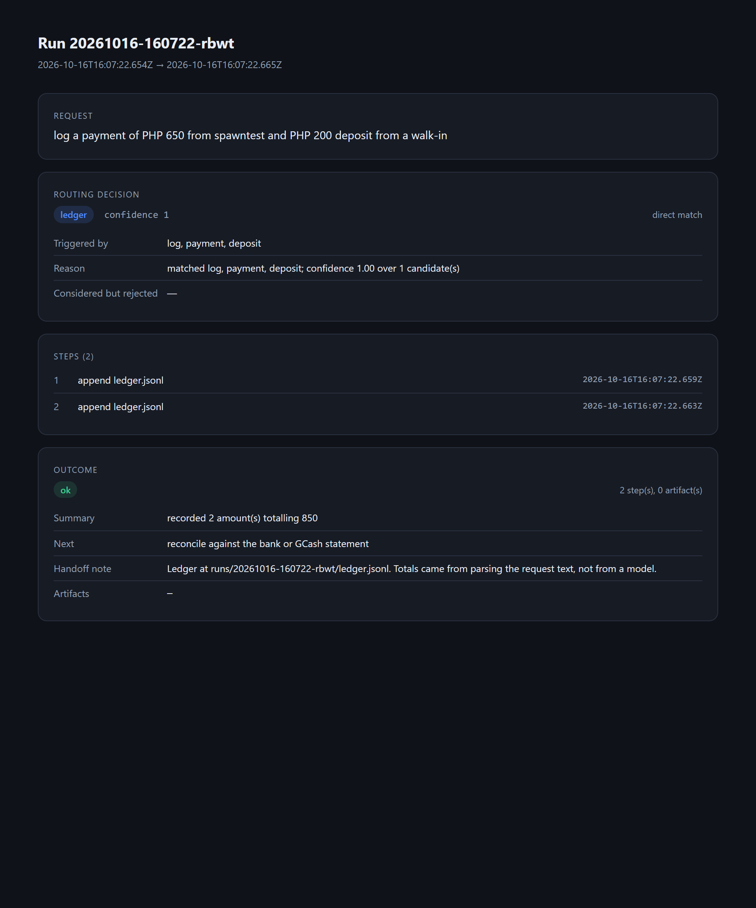

# agent-dispatch

A small, dependency-free dispatch layer for agent work: **explainable routing**,
**hard step budgets**, an **append-only run log**, and a **handoff** at the end
of every run — including the runs that fail.

No framework, no build step, no dependencies. Node 18+ and the standard library.



## Why it exists

I run a small agency where several agents (and several terminals) touch the same
work. Two problems kept costing me time:

1. **Silent misrouting.** An agent that guesses at the wrong task still produces
   confident output, and you only notice days later.
2. **Runs that end without a trace.** When a session dies halfway, the next
   agent re-does the work because nothing recorded what was done or what was
   supposed to happen next.

So the routing decision is logged *with its reasoning*, every run ends with a
handoff note, and no run can quietly loop — a capability that exceeds its step
budget is stopped and flagged.

## Quick start

```bash
node src/cli.js demo                            # five sample runs, fully offline
node src/cli.js "log a payment of PHP 650 from spawntest"
node --test                                     # 10 tests, no network
node src/cli.js report <runId>                  # writes an HTML run report
npm start                                       # same as: node src/cli.js
```

`demo` uses a stub model (`demo/stub-table.js`) that answers from a table, so the
whole pipeline runs with no API key and produces identical output every time.

Real sample output:

```
Offline demo run (stub model, no network, no API key)

  request    research how live comment auctions convert on Instagram
  routed to  research (confidence 1)
  matched    research
  status     ok after 1 step(s)
  summary    brief written with 3 points (3 lines)
  next       draft from the brief
  run id     20261016-160722-5l0k

  request    log a payment of PHP 650 from spawntest and PHP 200 deposit from a walk-in
  routed to  ledger (confidence 1)
  matched    log, payment, deposit
  status     ok after 2 step(s)
  summary    recorded 2 amount(s) totalling 850
  next       reconcile against the bank or GCash statement

  request    thing
  routed to  triage (confidence 0, fallback)
  matched    —
  status     ok after 1 step(s)
  summary    not routed confidently — 3 gap(s) written up
  next       a human answers the questions in handoff.md
```

## How routing decides

Routing is deliberately boring and inspectable: tokenise the request, count
declared triggers, weight phrases above single words, and require the winner to
clear a confidence floor.

```js
{
  picked: <capability>,        // null when nothing clears the floor
  confidence: 1,               // pick's share of all positive scores
  matched: ['log', 'payment'],
  rejected: [{ name: 'draft', score: 1, matched: ['message'] }],
  reason: 'matched log, payment, deposit; confidence 1.00 over 1 candidate(s)'
}
```

Below the floor, the request is **not** routed to the closest guess. It goes to
`triage`, which writes down what is missing instead of inventing work. Refusing
to guess is the feature I would not trade away.

## What a run records

Every run appends JSONL to `runs/log.jsonl` — one event per line, never mutated:

```json
{"at":"2026-10-16T16:07:22.654Z","run":"20261016-160722-rbwt","type":"request","text":"log a payment of PHP 650 ..."}
{"at":"...","run":"...","type":"route","picked":"ledger","confidence":1,"matched":["log","payment","deposit"],"reason":"..."}
{"at":"...","run":"...","type":"step","step":1,"label":"append ledger.jsonl"}
{"at":"...","run":"...","type":"handoff","status":"ok","steps":2,"summary":"recorded 2 amount(s) totalling 850","next":"reconcile against the bank or GCash statement"}
```

Because it is append-only, a run can be tailed while it is still happening and
replayed afterwards. Paths in the log are relative to the project root — a log
with someone's home directory in it is a log you cannot share.

`runs/report-<id>.html` renders the same events as a one-page report
(`docs/sample-report.html` is a real one, committed as an example).

## Steps, budgets, and the tool layer

Capabilities never touch the filesystem or the clock directly — they go through
`tools`. That gives the runner two things it could not get otherwise: **every
tool call counts as a step against the capability's budget**, and the log
records what was actually done rather than what a model says it did.

When the budget is exceeded the capability is stopped, an error event is
written, and the run still ends with a handoff:

```js
const result = await dispatch('greedy task', { /* ... */ });
// result.status === 'budget_exceeded'
// result.steps  === 3   (two writes allowed, the third tripped the limit)
```

## Adding a capability

One file, one object. This is the whole contract:

```js
module.exports = {
  name: 'invoice',
  summary: 'Build a receipt line for a completed sale.',
  triggers: ['invoice', 'receipt', 'bill the client'],
  budget: { maxSteps: 4 },
  async run({ request, model, tools }) {
    const file = tools.writeArtifact('receipt.md', '...');
    return {
      summary: 'receipt written',
      next: 'send it, then log the payment',
      handoff: `Receipt at ${tools.display(file)}. Nothing has been sent.`,
    };
  },
};
```

Register it in `capabilities/index.js`. Routing picks it up from `triggers`; no
other wiring.

## Using a real model

`stubModel` is for offline runs and stable tests. For real work:

```js
const { httpModel } = require('./src/model');
const model = httpModel({ model: 'gpt-4o-mini' });   // reads OPENAI_API_KEY
```

The adapter is ~20 lines: the dispatcher only needs
`complete({ system, prompt }) -> { text, tokens }`. Routing, budgets, logging,
and handoff are unchanged — which is the point of keeping the adapter thin.

## Limits (read this before borrowing it)

- Routing is **keyword-trigger based, not semantic**. It is predictable and
  cheap; it will not understand a cleverly rephrased request.
- **Single process, single machine.** The append-only log makes concurrent runs
  safe to *read*, not to coordinate — there is no locking or leasing here.
- **No retries and no scheduling.** A failed capability is logged and handed off,
  not retried. Deliberate: silent retries hide the misrouting this exists to
  surface.
- The four capabilities shipped here are demonstrations of the pattern, not a
  product.

## License

Published for reference only — all rights reserved. See [LICENSE](LICENSE).

---

Built by **Argelo Cumayas Nuñez** · [argelo.spawntel.com](https://argelo.spawntel.com) · [github.com/Arvoszn](https://github.com/Arvoszn)
